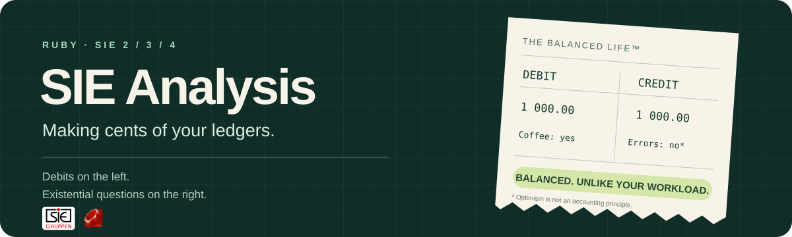

# SIE Analysis

Turn Swedish SIE exports into income statements, account movements, budget
comparisons and voucher details in Ruby.

## Get started

Requires Ruby 3.2 or newer. From a local checkout, build and install the gem:

```sh
gem build sie-analysis.gemspec
gem install ./sie-analysis-1.0.0.gem
```

Load an export and create an analyzer:

```ruby
require "sie_analysis"

text = File.read("export.se", encoding: "UTF-8")
# For a file declaring #FORMAT PC8 instead:
# text = File.read("export.se", encoding: "IBM437:UTF-8")
parsed = SieAnalysis::Parser.parse(text)
analysis = SieAnalysis::Analysis.new(parsed)
```

All monetary results are `BigDecimal`; date boundaries and voucher dates are
`Date` objects. Examples below abbreviate longer results with `...`.

## Income statement and monthly trends

```ruby
parsed = SieAnalysis::Parser.parse(File.read("spec/fixtures/sie_type2_sample.se"))
analysis = SieAnalysis::Analysis.new(parsed)
report = analysis.overview(
  from: Date.new(2024, 1, 1), to: Date.new(2024, 3, 31)
)
report[:income_statement].slice(:revenue, :expenses, :result)
# => { revenue: 0.3e6, expenses: 0.21e6, result: 0.9e5 }

report[:monthly_totals].map { |month| month.slice(:month, :revenue) }
# => [{ month: "2024-01", revenue: 0.1e6 }, ...]
```

The report also includes account groups, a balance sheet, cash and bank,
profit margin, budget information and explanatory notes.

## Find the accounts behind a total

```ruby
analysis.account_movements(month: "2024-01", account_number: 3010)
# => [{ account_number: 3010, account_name: "Forsaljning", group_code: "revenue",
#       movement: 0.1e6, dimension_code: nil, dimension_label: nil }]

analysis.account_summary(3010, month: "2024-03")
# => { account_number: 3010, opening_balance: 0.22e6,
#      movement: 0.8e5, closing_balance: 0.3e6, ... }
```

Omit `account_number` to list all non-zero account movements, or pass
`group_code: "revenue"` to select a report group.

## Break down results by project or cost center

```ruby
parsed = SieAnalysis::Parser.parse(File.read("spec/fixtures/sie_type3_sample.se"))
analysis = SieAnalysis::Analysis.new(parsed)
report = analysis.overview(
  from: Date.new(2024, 1, 1), to: Date.new(2024, 1, 31),
  dimension: :project
)
report[:income_statement][:groups].map { |group| group.slice(:code, :label, :amount) }
# => [{ code: "ABC", label: "Projekt ABC", amount: 0.15e5 }]
```

Use `dimension: :cost_center` for cost centers. `account_movements` accepts the
same dimensions, with `dimension_code: "ABC"` to select an object.
`analysis.available_dimensions` lists the available symbols. The export must contain the relevant object balances;
balance-sheet totals are omitted for dimension reports.

## Inspect the postings on an account

SIE 4 exports provide voucher details and single-day account checks:

```ruby
parsed = SieAnalysis::Parser.parse(File.read("spec/fixtures/sie_type4_sample.se"))
analysis = SieAnalysis::Analysis.new(parsed)
analysis.account_summary(3010, on: Date.new(2024, 3, 15))
# => { opening_balance: 0.22e6, movement: 0.5e3,
#      closing_balance: 0.2205e6, ... }

analysis.vouchers_on_account(
  3010,
  from: Date.new(2024, 3, 15), to: Date.new(2024, 3, 15)
)
# => [{ voucher_series: "", voucher_number: 5, date: Date.new(2024, 3, 15),
#       description: "March sale", movement: 0.5e3 }]
```

Each returned amount is the net movement on the selected account in that
voucher. The method returns all matching vouchers; apply sorting or pagination
in your script if needed.

## Compare actuals with a budget

```ruby
parsed = SieAnalysis::Parser.parse(File.read("spec/fixtures/sie_budget_sample.se"))
analysis = SieAnalysis::Analysis.new(parsed)
report = analysis.overview(
  from: Date.new(2026, 9, 1), to: Date.new(2026, 9, 30)
)
report[:budget][:rows].first.slice(:account_number, :budget, :actual, :variance)
# => { account_number: 3001, budget: 0.15416e5, actual: 0.2e5, variance: 0.4584e4 }
```

Budgets come from `PBUDGET` records. Variance is actual minus budget, not a
judgment of whether the difference is favorable. Missing budgets return
`status: "unavailable"`. All matching budget rows are returned, including explicitly exported zero budgets.

## Calculation behavior

- Overviews use monthly `PSALDO` changes. Date arguments select months; they do
  not filter individual postings. If an export was already date-filtered, its
  supplied balances are used as-is.
- Supply one financial year per analysis and validate the requested dates
  against that export. Years are not fetched or merged automatically.
- Income groups use BAS account ranges 3000–8999, including account 8999.
  Amounts use `BigDecimal` arithmetic and are rounded to two decimals using
  half-up rounding. Format them for display with `amount.to_s("F")`.
- Reports currently label currency as SEK. Only use SEK exports.
- Daily checks use voucher dates and require the preceding movements needed
  to calculate opening balances. They are not a full reconciliation of the
  export's transactions against its balances.
- Parsing failures raise `SieAnalysis::ParseError`. Invalid analysis arguments
  raise `ArgumentError`. Daily checks and voucher lists require SIE 4.
  Parsing validates the export type, financial-year headers and recognized
  financial rows; it is not full SIE validation.

## Development

From the repository directory:

```sh
bundle install
bundle exec rake                    # Run the complete test suite
bundle exec rspec spec/analysis_spec.rb
bundle exec irb -Ilib -rsie_analysis # Explore the library interactively
gem build sie-analysis.gemspec       # Build the distributable gem
```

Implementation lives in `lib/sie_analysis/`, examples of export data in
`spec/fixtures/`, and tests in `spec/`. Add a small synthetic fixture and a
regression test when changing parsing or calculations.

To use your checkout from another Ruby project during development:

```ruby
# Gemfile in the consuming project
gem "sie-analysis", path: "../sie-analysis"
```

Run `bundle install` there after adding the dependency.

## Releases

The version lives in `lib/sie_analysis/version.rb`. Update it and run
`bundle install` to refresh the lockfile before committing a release.
Push a matching tag, for example `v0.1.0`, to publish that version to RubyGems.
The release workflow runs the test matrix first and rejects a tag that does
not match the gem version. Pushing commits or opening/updating a pull request
does not publish a gem.

Before the first release, configure a RubyGems
[pending trusted publisher](https://rubygems.org/profile/oidc/pending_trusted_publishers)
with these values:

- Gem: `sie-analysis`
- Repository owner: `standout`
- Repository: `sie-analysis`
- Workflow filename: `release.yml`
- Environment: `release`

Publishing uses GitHub OIDC; no RubyGems API key is stored in this repository.
